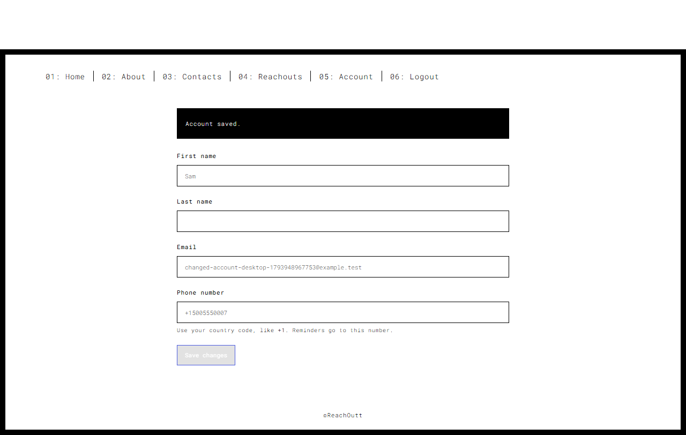
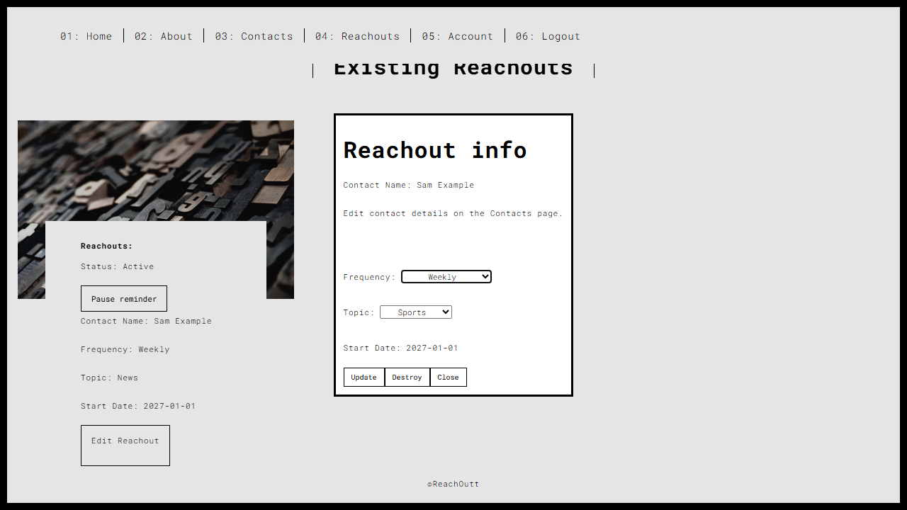

# ReachOutt

ReachOutt helps you stay in touch with friends and family. Add contacts, choose a reminder schedule, and get a text when it is time to reach out. Optional jokes, news, and sports suggestions help start a conversation.

The app uses Rails, Vue 3, and PostgreSQL. It is still a beta. Local use and PR previews keep message delivery off by default.

## Features

Manage your account, contacts, and reminders. Email changes require your current password. Password reset links expire after 15 minutes and work once. You can pause a reminder without deleting it. A reminder keeps its original contact, with contact details edited on the Contacts page.

## Local setup

Use Ruby 4.0.7, Node 24.15 or newer, and PostgreSQL 18. Copy `.env.example` to `.env` and set your local database connection.

```sh
bundle install
bundle exec rails db:prepare
bundle exec rails server
```

In another terminal, run `npm ci` and `npm run serve`. Open `http://127.0.0.1:8080/app/`. The dev server forwards API requests to Rails on port 3000.

For the production build, run `npm run build` and open Rails at `http://127.0.0.1:3000`. Build output goes to `public/app`. Set `RAILS_SERVE_STATIC_FILES=true` in production unless your web server serves that directory.

Run backend tests with `RAILS_ENV=test bundle exec rails db:prepare` and `bundle exec rails test`. On PowerShell, set `$env:RAILS_ENV='test'` before preparing the test database.

The app does not need the original encrypted credentials for local login. Production needs a PostgreSQL `DATABASE_URL` and a stable `SECRET_KEY_BASE`. Generate a secret with `bundle exec rails secret`. Keep an existing production secret when upgrading so current login tokens keep working.

Optional demo data is fictional. Set `SEED_DEMO=true` and run `bundle exec rails db:seed` in development. The demo login is `alex@example.test` with password `local demo password`.

## Tests

Run `npm test` for form tests. For browser tests, run `npm run build`, start Rails with SMS disabled, install Chromium with `npx playwright install chromium`, then run `npm run test:e2e`. Browser tests create fictional accounts in the database used by that server. Use a local or disposable database.

Run `npm run format:check` to check JavaScript and Vue formatting. Run `npm run format` to apply it. Backend checks include `bundle exec rails test` and `bundle exec rails zeitwerk:check`.

## Reminders

Run `bundle exec rails reminders:work` as a separate worker process. It checks schedules every minute. You can also run `bundle exec rails reminders:send` from an external scheduler. It reads due reminders from PostgreSQL. Start dates use UTC. Edits replace the schedule, and deleting a contact removes its reminders.

SMS is off by default. To enable it, set `SMS_ENABLED=true`, `TWILIO_ACCOUNT_SID`, `TWILIO_AUTH_TOKEN`, and `TWILIO_FROM_NUMBER`. News and sports suggestions also need `NEWS_API_KEY`. Failed suggestions do not block the reminder.

The migration preserves existing records. Valid old schedules become due at their start date or the migration time, whichever is later. Invalid old schedules stay paused until edited. Review existing reminders before enabling SMS.

Concurrent workers use row locks. Failed sends stay due for retry. A crash after Twilio accepts a message but before the database commits can still result in a duplicate on retry. Check Twilio delivery logs before manually retrying an uncertain send.

Reminders can be paused without deleting them. Resuming waits one full reminder interval, or until a future start date. Missed reminders are not sent in a burst. A message already being sent cannot be recalled.

## Free reminder scheduler

The Scheduled reminders workflow checks due records about every 15 minutes, independently of the sleeping web service. GitHub can delay or drop scheduled runs and disables schedules after 60 days of repository inactivity. This is a beta option for reminders that tolerate delays.

Create a GitHub environment named production and restrict it to the main branch. Add DATABASE_URL, TWILIO_ACCOUNT_SID, TWILIO_AUTH_TOKEN, TWILIO_FROM_NUMBER, and SMS_ALLOWED_RECIPIENTS as environment secrets. The recipient setting is a comma separated list of approved phone numbers in international format. Unapproved numbers cannot receive texts.

After approving recipients and Twilio costs, set the repository variable REMINDERS_ENABLED to true and run the workflow manually once. Check Twilio for actual delivery, then watch the scheduled runs in Actions. Failed sends make the run fail while leaving their schedules due for retry. Enable GitHub Actions failure notifications in your account settings. Missing runs need separate monitoring, since a skipped schedule cannot report its own failure.

Leave the variable unset to keep the scheduler off. Keep SMS_ENABLED false on the web service. Do not put production secrets in pull request workflows. The scheduler uses a temporary Rails signing key and does not need the web app's login signing key.

## Password reset email

Development writes reset emails to `tmp/mail`. Production needs a trusted HTTPS `APP_URL`, a verified `MAIL_FROM`, and your provider settings in `SMTP_ADDRESS`, `SMTP_PORT`, `SMTP_USERNAME`, and `SMTP_PASSWORD`. Reset links expire after 15 minutes. A completed reset signs out existing sessions. Email delivery must be configured and tested with your provider before offering resets to users.

## Heroku setup

Production redirects user traffic to HTTPS and logs at info level. Use `/health/ready` for hosting health checks. It checks PostgreSQL and returns 503 if the database is unavailable. `/up` only checks that Rails is running. Neither endpoint exposes connection details.

The Procfile runs database migrations during release and defines separate web and reminder processes. Configure the Node.js buildpack before Ruby so the Vue build is included. The app still uses Vue 3, Vue Router 5, and Vite 8.

Keep your existing PostgreSQL database and stable `SECRET_KEY_BASE`. Configure `DATABASE_URL` and `RAILS_SERVE_STATIC_FILES=true`. Enable one worker with `heroku ps:scale worker=1 --app YOUR_APP` after checking your plan and costs. Creating a Procfile alone does not enable a worker.

Schedules and pause status live in PostgreSQL. A restarted worker resumes from those records instead of losing timers. The worker still needs to be running for messages to go out. Set the SMS and email settings above only when you are ready to enable delivery. This repository does not provision hosting or send a test text automatically.

## PR previews

PR Preview Action v1.8.2 publishes frontend previews for branches in this repository and removes them when the PR closes. Fork and Dependabot PRs are skipped because they do not have the required write permissions.

Previews use fictional records and replace HTTP requests with a local, read only adapter. They cannot access Rails, save changes, send email, or send texts. Hash routing keeps links working under each PR folder on GitHub Pages. Production builds still use the Rails API and normal routes.

GitHub Pages must publish the root of the `gh-pages` branch. The preview workflow has permission to write that branch and leave a preview link on the PR. Full backend behavior is covered by the Rails and browser tests.

## Code guide

See [database backups](docs/backups.md) for encrypted exports, the optional daily schedule, and a restore check. Backups are not active until configured and tested.

See [the code guide](docs/code-guide.md) for the folder layout, authentication flow, reminder lifecycle, and editing conventions. Keep unrelated work in separate PRs and include desktop and mobile screenshots for review.

## Screenshots





## Contact

dorsetttaylordev@gmail.com
